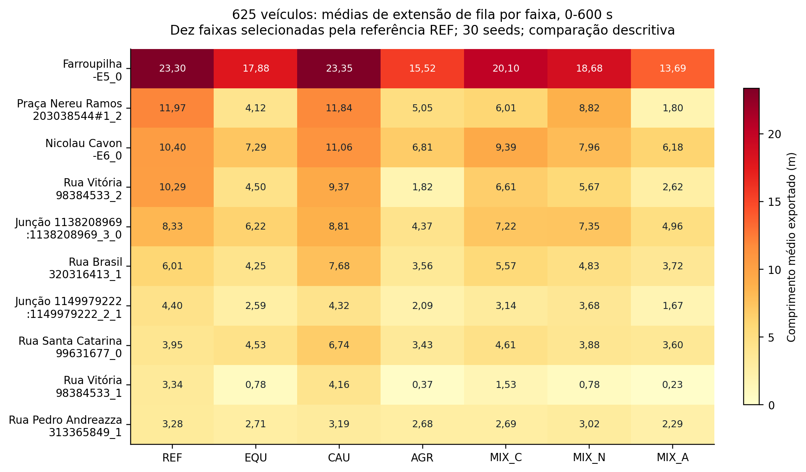
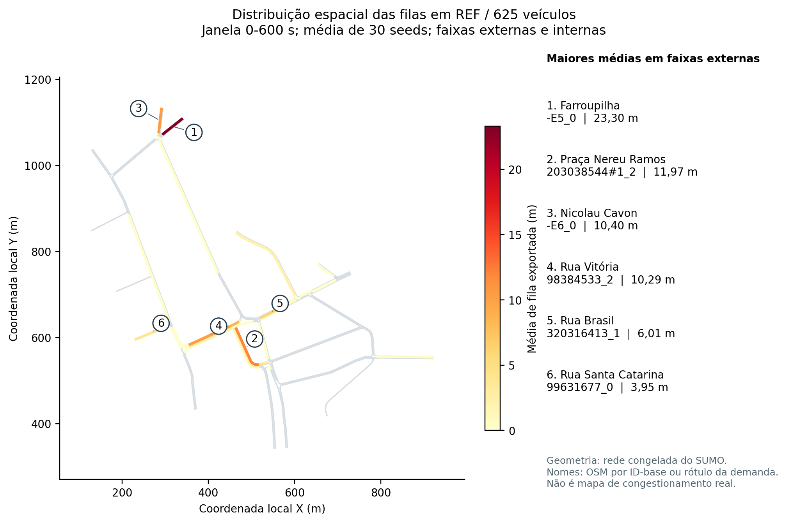

# Localização das filas e comparação dos cenários - v1.0

Data: 14/10/2026. Análise descritiva exploratória do experimento congelado do TC de Valdir Rugiski Junior. Complementa a interpretação integrada das cinco métricas. Não acrescenta testes ou intervalos à família inferencial de tempo de viagem.

## O que esta etapa acrescenta

As filas não estão distribuídas uniformemente na rede. É possível apontar faixas que concentram grande parte do comprimento agregado e observar onde as composições aumentam ou reduzem esse indicador. Uma redução global também pode coexistir com aumento local.

O arquivo recebido cobre 630 execuções, 30 seeds, três demandas, sete composições, 198 faixas e duas janelas. São 249.480 registros. O SHA-256 coincide exatamente com o manifesto da consolidação. Nenhuma seed, faixa ou observação foi excluída.

As somas por faixa reproduzem os valores globais da base, incluindo categorias externas/internas e campos principal/experimental. O maior resíduo absoluto dessa conferência é inferior a 0,000000001 m, compatível com o arredondamento das tabelas. Isso verifica a consistência com a consolidação; não é nova validação empírica da rede.

## Onde as filas se concentram

Em REF com 625 veículos, as cinco faixas de maior média somam 64,28 m dos 103,12 m agregados: **62,34%** do total. As dez maiores somam **82,67%**. Essas parcelas são razões entre somas das médias; não são porcentagem de veículos ou média de percentuais por seed.

| Faixa | Nome auxiliar | Média (m) | Presença média (%) |
|---|---|---:|---:|
| `-E5_0` | Farroupilha | 23,30 | 72,42 |
| `203038544#1_2` | Praça Nereu Ramos | 11,97 | 27,21 |
| `-E6_0` | Nicolau Cavon | 10,40 | 55,08 |
| `98384533_2` | Rua Vitória | 10,29 | 22,29 |
| `:1138208969_3_0` | Interna da junção 1138208969 | 8,33 | 42,54 |
| `320316413_1` | Rua Brasil | 6,01 | 40,90 |
| `:1149979222_2_1` | Interna da junção 1149979222 | 4,40 | 38,21 |
| `99631677_0` | Rua Santa Catarina | 3,95 | 36,94 |
| `98384533_1` | Rua Vitória | 3,34 | 6,59 |
| `313365849_1` | Rua Pedro Andreazza | 3,28 | 45,44 |

Os nomes Farroupilha e Nicolau Cavon dos acessos `-E5` e `-E6` são rótulos da configuração congelada de demanda. Ambos terminam na junção J6 do modelo. Os nomes Praça Nereu Ramos e Rua Vitória foram recuperados do OSM do repositório pelo ID-base dos trechos. O ID da faixa continua sendo a identificação precisa da observação.

A conexão interna `:1138208969_3_0`, quinta colocada, corresponde ao movimento da faixa 2 do trecho `98384533` para a faixa 0 de `99370098#0`, conforme a conexão `via` na rede congelada. Os nomes OSM associados são Rua Vitória e Rua Nicolau Cavon. Esse vínculo foi conferido na estrutura da rede, não inferido pela proximidade no desenho.

Há 104 faixas internas de junções e 94 externas. Em REF/625, as externas respondem por 85,25 m e as internas por 17,88 m do total médio. As faixas internas permanecem na análise e são identificadas separadamente; não devem ser tratadas como ruas independentes nem apagadas para simplificar o total.

## O padrão muda com o carregamento

Na demanda 300, a maior média de REF é da conexão interna `:1149346334_4_0`, com 0,77 m. Pela rede, esse movimento liga o trecho `313365849` ao `305933406`, com nomes OSM Rua Pedro Andreazza e Avenida Dom Pedro II.

Em 450 e 625, a faixa `-E5_0` tem a maior média de REF: 4,09 m e 23,30 m, respectivamente. Em 625, faixas da Praça Nereu Ramos e Rua Vitória passam a ter participação expressiva. O conjunto dos pontos de maior retenção depende da demanda; um único máximo global não descreve essa distribuição.

As cinco maiores faixas de REF respondem por 72,68%, 59,42% e 62,34% dos totais nas demandas 300, 450 e 625. Essa concentração não mede, sozinha, intensidade: o total em 300 é muito menor que em 625.

## Como as composições se comparam nos mesmos locais

As dez faixas dos gráficos foram selecionadas pela média de REF/625 e mantidas iguais para todos os cenários. A seleção usa a mesma coleta e é exploratória. As tabelas completas preservam as outras faixas e demandas.

Em 625, no acesso Farroupilha (`-E5_0`), a média passa de 23,30 m em REF para 15,52 m em AGR e 13,69 m em MIX_A. Na faixa `203038544#1_2` da Praça Nereu Ramos, passa de 11,97 m para 5,05 m e 1,80 m, respectivamente. Na faixa `98384533_2` da Rua Vitória, passa de 10,29 m para 1,82 m e 2,62 m.

Portanto, MIX_A tem média menor que AGR em alguns pontos importantes, mas AGR tem média menor na faixa citada da Rua Vitória. O menor total de MIX_A não significa menor fila em cada local. Esses são resultados descritivos das médias, não comparações locais com significância estatística.

### Um aumento local apesar da redução global

Na faixa `99370098#0_0`, associada pelo OSM à Rua Nicolau Cavon, ocorre o seguinte em 625:

| Cenário | Extensão média de fila (m) | Presença média nos registros (%) |
|---|---:|---:|
| REF | 2,92 | 57,44 |
| AGR | 3,58 | 46,71 |
| MIX_A | 3,93 | 48,91 |

AGR e MIX_A têm maior comprimento médio nesse ponto, embora a fila seja registrada em menor fração dos instantes. Comprimento e frequência de presença descrevem aspectos diferentes. A tabela não informa a duração do maior episódio contínuo de fila.

No total de todas as faixas, AGR reduz a média agregada em 45,03 m ante REF; MIX_A, em 51,96 m. A decomposição de AGR contém cerca de +0,84 m de contribuições positivas e -45,87 m de negativas. Para MIX_A, são +1,03 m e -52,99 m. O saldo favorável é dominado pelas reduções, mas os aumentos locais são preservados no relatório.

Essas contribuições de médias se somam algebricamente. Não são uma medição de fila contínua, transferência dos mesmos veículos entre locais ou identificação causal de propagação. Para investigar o mecanismo seriam necessárias as séries temporais e, conforme a pergunta, trajetórias e movimentos.

## Filas depois de encerrar a geração da demanda

Como a tabela fornece médias das janelas [0,600) e [0,1800), pode-se obter a média de [600,1800) por diferença das áreas temporais:

`media_600_1800 = (1800 * media_0_1800 - 600 * media_0_600) / 1200`.

Os zeros e o período já sem veículos continuam incluídos. Por isso esta média não representa a média apenas durante o tempo em que ainda havia fila. Os máximos da fase posterior não podem ser deduzidos subtraindo máximos.

| Composição, demanda 625 | Soma média das extensões em [600,1800) (m) |
|---|---:|
| REF | 11,30 |
| EQU | 4,96 |
| CAU | 12,88 |
| AGR | 3,10 |
| MIX_C | 7,17 |
| MIX_N | 6,76 |
| MIX_A | 2,91 |

Em REF/625, os maiores componentes médios dessa fase posterior são `-E5_0`, `-E6_0` e `203038544#1_2`, mantendo acessos e trecho da praça entre os pontos relevantes também na drenagem. Não se conclui daí a ordem de propagação da fila ou sua duração contínua.

Para presença, o cálculo usa diferenças das contagens de amostras positivas, recuperadas da porcentagem e do número de amostras. Resíduos negativos diminutos da média derivada, decorrentes de arredondamento decimal, foram limitados a zero somente quando dentro da tolerância de 0,0000001 m. A quantidade está registrada no manifesto. Os dados originais não foram corrigidos ou substituídos.

## Nomes, geometria e limites da interpretação

Todos os nomes vieram vazios na tabela original. O mapeamento auxiliar preserva a origem do rótulo: 73 faixas externas com nomes do OSM por ID-base, oito com rótulos da demanda e 13 sem nome disponível. As 104 internas são identificadas pela junção da rede. Não foram inventados nomes para preencher as lacunas.

A geometria do mapa é a do snapshot congelado e teve seu hash conferido com o manifesto oficial. O OSM consultado foi `mapa/nereu_ramos.osm`, do repositório `valdirjunior/tc-valdir`, blob Git `dd3a851168dbd986f788df09e250380ca8a17440`. Os rótulos são uma associação de fontes do projeto, não confirmação atual dos nomes ou do trânsito real das vias.

O mapa mostra médias do modelo, não uma fila fotografada num instante. Uma cor forte indica maior média naquela faixa, não maior risco ou significância estatística.

Em 7.522 registros das duas janelas, o máximo exportado supera o comprimento nominal da faixa. A extensão exportada é baseada em posições de veículos, conforme o protocolo de extração, e não deve ser convertida automaticamente em taxa de ocupação física. Não foi calculado percentual de capacidade nem classificado bloqueio ou spillback por essa razão.

Presença é a fração de instantes amostrados com comprimento exportado positivo. Não informa se esses instantes são consecutivos, quantos episódios ocorreram ou quanto durou o maior. Para essas perguntas, é preciso voltar ao `queues.xml` das execuções selecionadas ou extrair a série temporal da coleta já existente.

## Arquivos e uso no TCC

- `resumo_por_faixa.csv`: 8.316 resumos, 30 seeds por combinação, incluindo as duas janelas e todas as faixas.
- `contrastes_pareados_por_faixa.csv`: 7.128 diferenças descritivas ante REF, com dispersão e contagens de sinais. Sem testes ou intervalos.
- `metadados_faixas.csv`: IDs, categorias, nomes, origens dos nomes e geometria local das 198 faixas.
- `fase_600_1800_derivada.csv`: resultados descritivos da janela posterior, derivados de estatísticas aditivas.
- `concentracao_REF.csv` e `decomposicao_diferencas.csv`: participação dos principais locais e composição dos saldos.
- `reconciliacao.csv` e `manifesto_analise_espacial.json`: conferências, fontes, versões, parâmetros e hashes.
- Gráficos PNG/SVG: comparação das faixas e mapa da rede.

Esta etapa permite discutir **onde** se concentram as maiores extensões e como as médias locais mudam entre composições. A explicação de **como** uma retenção se forma e se propaga exige análise temporal adicional. O capítulo de resultados pode usar esta leitura espacial junto das cinco métricas, preservando a distinção entre descrição espacial e inferência temporal já realizada.

## Gráficos

